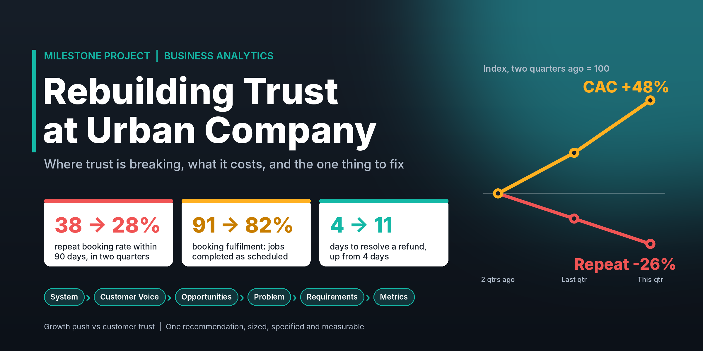

<h1 align="center">Urban Company — Rebuilding Trust: Milestone Project on Growth vs. Customer Trust</h1>

<p align="center">
  
  
  
  
</p>

<p align="center">
  
</p>

## Overview

Urban Company listed publicly in September 2025 and has pushed into new lines of business (InstaHelp and the Native product range) while its core services business is close to breaking even. Revenue keeps climbing, but customers describe no-shows, last-minute cancellations, slow refunds and hard-to-reach support, even though the in-app service rating still looks excellent. The project takes this from first signal to a buildable recommendation, working through system map → customer voice → opportunity sizing → problem statement → requirements → metrics, using systems thinking, opportunity sizing with stated assumptions, a weighted decision matrix, user stories with acceptance criteria and a metrics hierarchy.

## The Problem

Illustrative internal dashboard, quarters oldest to newest:

| Metric | Two quarters ago | Last quarter | This quarter |
|---|---|---|---|
| Repeat booking rate (within 90 days) | 38% | 33% | **28%** |
| Avg bookings per active customer per quarter | 2.4 | 2.1 | **1.8** |
| Blended customer acquisition cost (CAC) | Rs 420 | Rs 510 | **Rs 620** |
| Booking fulfilment rate | 91% | 86% | **82%** |
| Support contact rate | 6% | 9% | **13%** |
| Avg refund resolution time | 4 days | 7 days | **11 days** |

Context used for sizing: about 7 million customers have used the platform, average contribution is about Rs 190 per completed booking, and Finance treats an LTV to CAC ratio below 3:1 as a warning sign.

The central question: *where is trust breaking, what is it costing, and what is the single most important thing to fix?*

## Frameworks Applied

| Framework | Used for |
|---|---|
| Systems thinking and feedback loops | Showing how the growth push and the customer experience feed each other |
| Voice-of-customer analysis | Reading public complaints against the internal dashboard and the in-app rating |
| Opportunity sizing with explicit assumptions | Putting a rough business value on each direction |
| Weighted decision matrix | Choosing one direction on criteria set and weighted in advance |
| Problem framing | Stating the problem in one testable sentence |
| User stories + acceptance criteria | Turning the recommendation into buildable, verifiable pieces |
| Metrics hierarchy | One outcome metric, early signals and guardrails tied to the money |

## Approach

1. **System and Business Case** — Mapped the reinforcing loop between reliability, support load, refunds, trust, repeat rate and acquisition pressure.
2. **Customer Voice** — Compared the public complaint themes with the dashboard and explained the gap with the in-app rating.
3. **Opportunities** — Sized three directions with stated assumptions and scored them on weighted criteria.
4. **Problem Statement** — Reduced the evidence to one sentence that any proposed solution can be tested against.
5. **Requirements** — Wrote business scope and user stories with acceptance criteria.
6. **Metrics** — Built the outcome, early-signal and guardrail framework and linked it to unit economics.

## Key Insights

- **Every operating metric is moving the wrong way together** — Fulfilment is down 9 points, support contacts have more than doubled (6% to 13%), refunds take 2.75 times as long (4 to 11 days), and repeat bookings are down 26% in relative terms (38% to 28%).
- **Growth is getting more expensive while customers are worth less** — CAC is up 48% (Rs 420 to Rs 620) while bookings per customer fell 25% (2.4 to 1.8). Treating repeat rate as a retention proxy, LTV to CAC has fallen by more than half (an index of about 0.44 versus two quarters ago), which hits the profitable-growth story a newly listed company has to tell.
- **Failed jobs are the likely first domino** — About 18% of bookings are not completed as scheduled, in the same range as the 13% that raise a ticket. This is an inference, but it suggests failed bookings could explain most of the support load.
- **Buying more customers into a leaky experience is not growth** — Falling repeat rate forces more paid acquisition at a rising CAC, which adds pressure on operations and further hurts reliability.

**The loop**

*Growth push into new verticals and more acquisition → operations stretched → reliability slips (no-shows, cancellations) → support load rises and refunds slow → trust falls → repeat rate drops → more paid acquisition needed at a higher CAC → more pressure to grow.* It is a reinforcing loop, and without a break it compounds.

**Customer voice, and the rating gap**

Public review platforms, app store reviews and forums repeat the same themes: professionals not turning up, last-minute cancellations with a fee still charged, prepayment with no service delivered, slow or denied refunds, hard-to-reach support, and after-sales denied on Native products under warranty. These match what the dashboard shows (fulfilment, support contacts and refund time).

The gap between a very high in-app rating (above 4.5) and low public ratings is itself a finding. Likely reasons, to be verified with the data: in-app ratings are only collected after a completed job, so the roughly 18% of bookings that fail never produce a rating, while public platforms attract customers who have a complaint. Neither number is the whole truth, so both should be read together and neither taken at face value.

**Opportunities sized** (rough, quarterly; assumptions below)

| # | Direction | Assumed repeat-rate uplift | Estimated prize per quarter |
|---|---|---|---|
| A | **Slot reliability:** make the booked slot dependable | +5 points | **Rs 10.4 crore** (Rs 6.0 crore retention + Rs 4.4 crore recovered bookings) |
| B | **Fast refunds and reachable support** | +3 points | Rs 3.6 crore |
| C | **Post-service rebooking and re-engagement** | +2 points | Rs 2.4 crore |

Assumptions: active customers per quarter are 25% of the 7 million users (1.75 million); each extra repeating customer is worth 2 further bookings at Rs 190 contribution plus half of the Rs 620 CAC avoided, about Rs 690; so each +1 point of repeat rate is worth roughly Rs 1.2 crore per quarter. For A, raising fulfilment from 82% to 88% on about 3.84 million scheduled bookings recovers about 230,000 completed bookings. The uplift per direction is my judgement and is the most uncertain input.

**Decision matrix (weights and scores are my own judgement, scored 1 to 5)**

| Criterion | Weight | A: Slot reliability | B: Refunds and support | C: Rebooking |
|---|---|---|---|---|
| Size of prize | 30% | 5 | 3 | 2 |
| Strength of evidence | 25% | 5 | 4 | 2 |
| Can start this quarter | 20% | 3 | 4 | 5 |
| Fits constraints (no extra ad spend, supports new verticals) | 15% | 5 | 4 | 3 |
| Cross-team feasibility | 10% | 3 | 4 | 5 |
| **Weighted score** | | **4.40** | 3.70 | 3.05 |

**Recommendation: Direction A, slot reliability.** It wins on size and evidence, and it sits upstream of the other problems because a failed booking is what creates the ticket, the refund and the lost customer. B stays valuable as a recovery layer but treats the consequence rather than the cause, and C relies on customers who had a good first experience.

**Problem statement:** *Urban Company too often fails to deliver the slot a customer has already paid for, and recovers too slowly when it does, so customers lose trust in the core promise and do not rebook.*

Any proposed fix can be tested against this: it must either raise the share of paid slots that are actually served, or shorten and soften the recovery when they are not. More advertising or new categories does neither.

**Requirements: business view**

| | |
|---|---|
| Why | Rebuild the core trust that repeat business and every new vertical depends on, to protect unit economics |
| In scope (assumed: core home services in launch cities) | Confirming a professional before taking payment, automatic backup assignment, automatic refunds for failures caused by Urban Company, an operations view of slots at risk |
| Success | Higher 90-day repeat rate, supported by better fulfilment and faster refunds |
| Deliberately out of scope | More acquisition spend, new vertical changes, pricing changes, Native after-sales redesign, and a full rebuild of the support tool |

**Requirements: user stories and acceptance criteria**

*Story 1: Pay only for a slot that will be served.* As a customer booking a service, I want a professional confirmed before I pay so that I am not charged for a slot nobody will serve.
- **Given** I choose a slot, **when** no professional has confirmed it, **then** payment is not captured and I am offered the next available slot.
- **Given** a professional has confirmed, **when** I pay, **then** my confirmation shows the arrival window and the professional's name.

*Story 2: Get a replacement, not silence.* As a customer whose professional can't come, I want to be reassigned or told early so that I am not left waiting.
- **Given** the professional cancels or has not accepted by a set cut-off (assumed 30 minutes before the slot), **when** the system detects it, **then** it tries a backup professional first.
- **Given** no backup is available, **when** I am notified (assumed within 5 minutes), **then** I can choose to reschedule or take a full refund.
- **Given** Urban Company or the professional causes the cancellation, **when** it happens, **then** no cancellation fee is charged to me.

*Story 3: Get refunded without chasing.* As a customer charged for a booking that failed, I want an automatic refund so that I don't have to raise a ticket.
- **Given** a booking is marked failed because of Urban Company, **when** it is recorded, **then** a refund starts automatically and I can see its status in the app.
- **Given** the refund is started, **when** it is processed, **then** it reaches the customer within the target of 3 days (assumed).

*Story 4: See slots at risk early.* As an operations manager, I want a view of upcoming slots at risk by city and time so that I can add capacity before they fail.
- **Given** slots for the next 24 to 48 hours, **when** a slot has no confirmed professional or no backup coverage, **then** it appears on the at-risk view.
- **Given** the at-risk count crosses a set threshold, **when** it does, **then** the operations lead receives an alert.

**Metrics framework**

| Level | Metric | Purpose |
|---|---|---|
| **Outcome (the one to move)** | 90-day repeat booking rate (28% now) | Directly measures regained trust |
| Early signals (weeks) | Booking fulfilment rate · share of bookings with a confirmed professional before payment · cancellations caused by Urban Company · support contact rate · average refund resolution time | Show within weeks whether the fix is working |
| Guardrails | Booking conversion rate · professional utilisation and earnings · contribution per booking (Rs 190) · CAC | Warn if reliability is fixed by hiding supply, hurting professionals or cutting margin |

*Link to the money:* each +1 point of repeat rate is worth about Rs 1.2 crore per quarter under the assumptions above, through more bookings per customer, longer customer lifetime and less dependence on paid acquisition. That is the line from the repeat-rate metric back to LTV to CAC and the unit economics Finance is watching.

## Recommendations

| # | Recommendation |
|---|---|
| 01 | Pursue one direction: make the booked slot dependable (slot reliability), instead of spending more on acquisition |
| 02 | Confirm a professional before capturing payment, and add automatic backup assignment |
| 03 | Refund Urban Company-caused failures automatically and remove cancellation fees for them |
| 04 | Give operations a view of at-risk slots so capacity is added before failures happen |
| 05 | Track the 90-day repeat rate as the outcome, with fulfilment and refund time as early signals and conversion and professional earnings as guardrails |

## Repository Structure

```
urban-company-trust-case-study
├── Urban_Company_Milestone_Project.pdf   ← Full analysis document (add your file here)
├── Appendix_Review_Sample.pdf            ← Tagged review sample and source links (add your file here)
├── cover.png                             ← Repo cover image
└── README.md
```

---

## About Me

**Anmol Agarwal**
Business Analyst

[](https://www.linkedin.com/in/anmol-agarwal123/)
[](https://github.com/Anmolagarwal19)
[](mailto:agarwalanmol799@gmail.com)

*If this project was useful, a star on the repo is appreciated — feel free to reach out for feedback, questions, or opportunities.*
